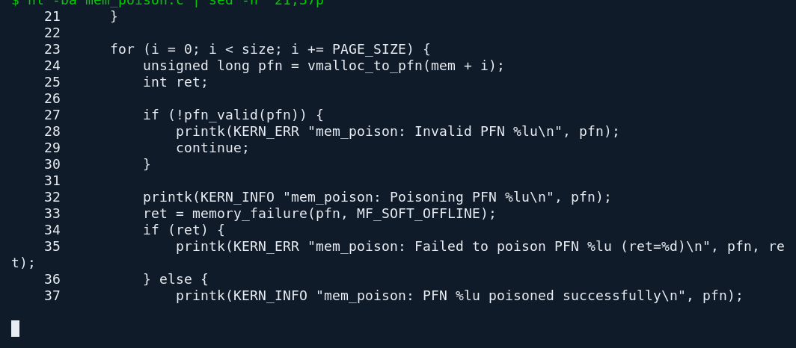
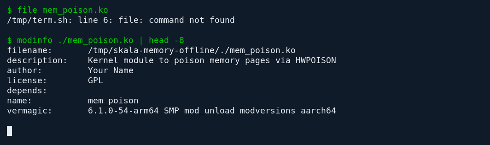

# Memory Offline

Модуль выделяет область через vmalloc, получает номера физических страниц и передаёт их в memory_failure. Размер области в исходнике задан константой POISON_MB и составляет 512 МиБ.



*Обход страниц выделенной области памяти*



*Сведения о модуле, собранном для Linux 6.1 ARM64*

## Запуск

Для воспроизведения сборки нужны Linux, make, компилятор C и заголовки ядра. Метаданные готового файла можно прочитать без загрузки модуля.

```bash
make
modinfo ./mem_poison.ko
```

## Что проверено

Файл mem_poison.ko собран с заголовками Debian Linux 6.1 ARM64 и проверен через modinfo. Модуль не загружался. Загрузка затрагивает память работающего ядра, поэтому функциональный эксперимент требует отдельной одноразовой виртуальной машины.

## Авторство

Вячеслав Георгиевич Кузнецов. Скала^р, задание 2.
